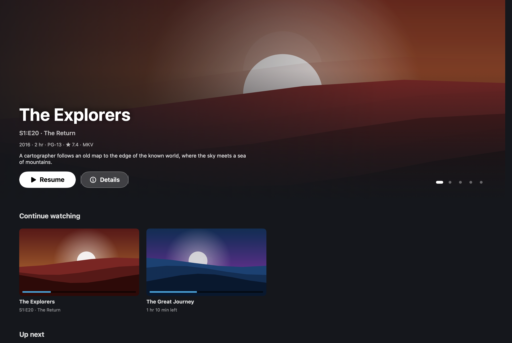
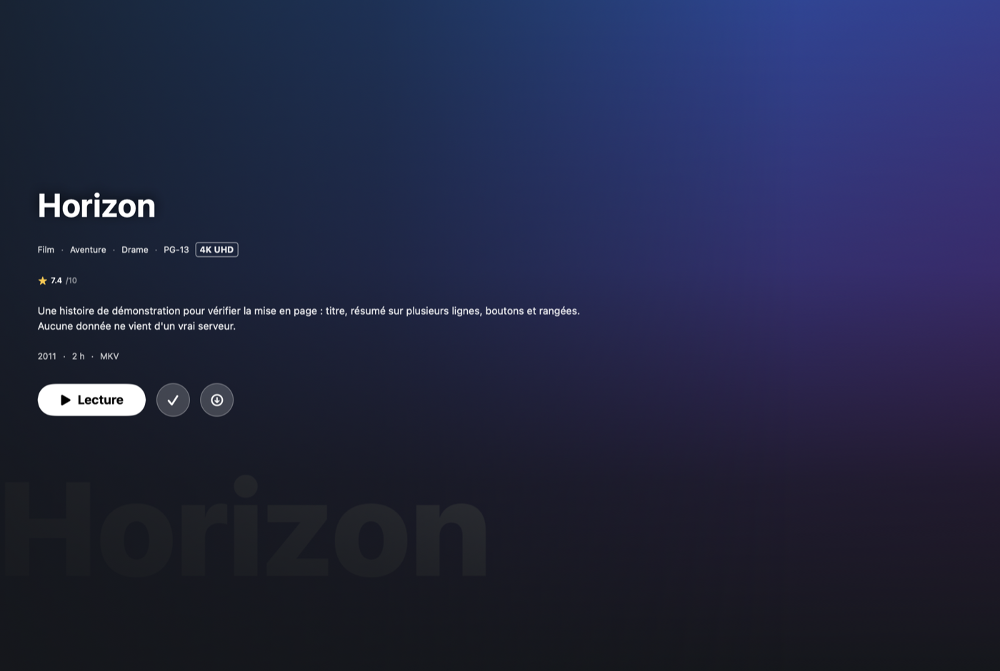
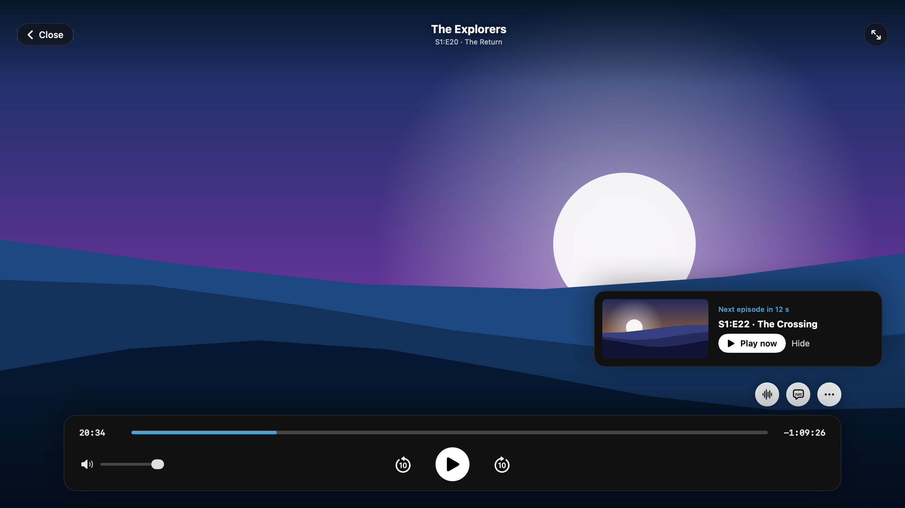
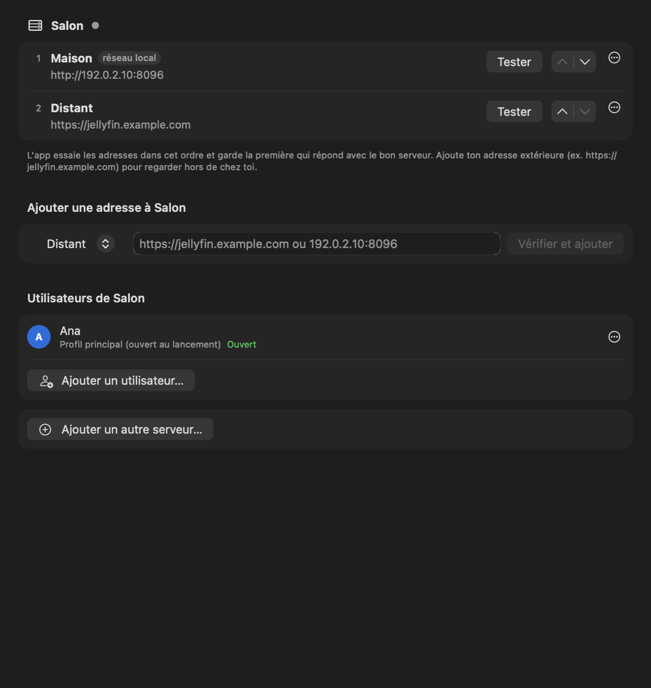
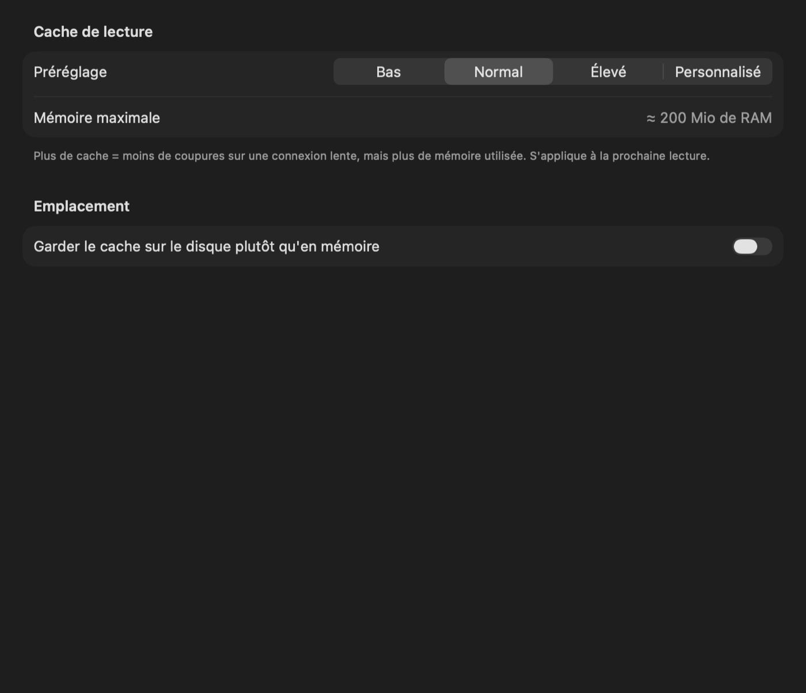

# Playfin

**A fast, native macOS client for Jellyfin.**

Playfin is an independent, open-source client for [Jellyfin](https://jellyfin.org) servers. It is not affiliated with or endorsed by the Jellyfin project. The interface is inspired by Plex on TVs: a big visual at the top, rows of posters, few screens, and playback one click away.

> The interface is in English (see `docs/decisions/0011-final-name-language-and-distribution.md`).



*Screenshots are rendered from the app's views with demo data (`ScreenshotTests`), not taken from a real server.*

## Features

- **Instant start**: Home, libraries, seasons and episodes show from the local cache at once, then refresh in place.
- **Plays almost anything without transcoding**: embedded mpv (LGPL build) with VideoToolbox hardware decoding, precise seeking, subtitles lifted above the controls, audio and subtitle menus grouped by language, tracks remembered per series, "Skip intro / credits" (server segments, Jellyfin 10.10+), next-episode card and auto-play.
- **Several addresses per server**: home and remote addresses are probed in parallel; the app keeps the best one that answers with the right server ID, and switches when the network changes. You can reorder, test or force an address.
- **Several profiles**: users and servers in the Profiles menu (⌃⌘1…9) and in Settings, each with its own cache, Keychain token and downloads.
- **Downloads and offline**: a segmented multi-connection downloader written in Rust (aria2-style) with resume after quit or crash, ETag check, address switching, retries, bandwidth limit and a free-space check. Downloaded items browse and play without the server, and playback positions made offline are synced when the server comes back.
- **Search across all libraries**, keyboard shortcuts (⇧⌘/ lists them), Settings (⌘,) for playback, player cache, downloads, storage and diagnostics.

| | |
|---|---|
|  |  |
|  |  |

## Requirements

- macOS 14 Sonoma or later, Apple silicon or Intel (universal app).
- A Jellyfin server, version **10.9 or later** (10.10+ for "Skip intro"). Tested versions are listed in `docs/decisions/0009-tested-jellyfin-versions-and-localization.md`.

## Install

### Homebrew

```bash
brew tap playfin-app/tap
brew trust playfin-app/tap   # recent Homebrew versions ask to trust third-party taps once
brew install --cask playfin
```

Updates: `brew upgrade --cask playfin`.

### Manual download

Download `Playfin-macOS.zip` from the [GitHub Releases page](https://github.com/playfin-app/playfin/releases), unzip it and drag `Playfin.app` to `/Applications`.

### First launch (Gatekeeper)

Builds are signed ad hoc but not notarized (there is no paid Apple Developer account yet), so macOS blocks the first launch once:

- **System Settings → Privacy & Security → Open Anyway**, or
- in Terminal: `xattr -dr com.apple.quarantine /Applications/Playfin.app`

The Homebrew cask does this step for you.

## Build from source

```bash
brew install xcodegen swiftlint gitleaks
rustup target add aarch64-apple-darwin x86_64-apple-darwin
scripts/build-xcframework.sh   # Rust core + Swift bindings + Xcode project
scripts/test-all.sh            # all checks: Rust and Swift tests, Clippy, fmt, SwiftLint, secrets, hosts
scripts/package-release.sh     # universal, signed app and zip in build/Release
```

Architecture: a platform-independent Rust core (`core/`: API, auth, profiles and address selection, cache, downloads, offline sync, settings) exposed to Swift with UniFFI, a SwiftUI app (`macos/`), and mpv for decoding and rendering. Design decisions are in `docs/decisions/`.

## Privacy

- Your token is stored only in the macOS Keychain. It is never written to logs or to the diagnostics export.
- The app talks only to your Jellyfin server. There is no analytics and no third-party service.

## Contributing

See [CONTRIBUTING.md](CONTRIBUTING.md). Bug reports and ideas are welcome through the issue templates.

## Licence

Playfin is released under the **Mozilla Public License 2.0** (`LICENSE`). It embeds mpv and FFmpeg in their LGPL build, linked dynamically; the full list of third-party components and licences is in [THIRD_PARTY_LICENSES.md](THIRD_PARTY_LICENSES.md) and in the app (Settings → About).
